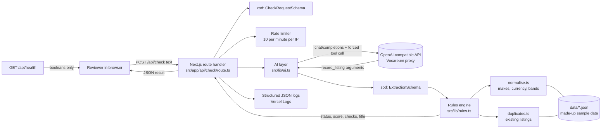

# Architecture Notes: ListingLint

## System overview

## Layers

| Layer | Files | Responsibility |
|---|---|---|
| UI | `src/app/page.tsx`, `src/components/ListingChecker.tsx` | Text input, example buttons, result view, copy seller message. Client component; never sees the key. |
| API | `src/app/api/check/route.ts` | Rate limit, input validation, call AI, run rules, return JSON. Maps all failures to error codes. |
| AI | `src/lib/ai.ts` | Builds the request (system prompt, listing wrapped in `<listing>` tags, forced `record_listing` tool), calls the endpoint with a 25 s timeout, parses and validates the tool call. |
| Rules | `src/lib/rules.ts`, `normalise.ts`, `duplicates.ts` | Pure functions: required fields, ranges, hours per year, currency, price bands, make normalisation, duplicates, score, status, title, seller message. |
| Data | `data/makes.json`, `data/price-guides.json`, `data/listings.json` | Made-up reference data bundled at build time. |
| Ops | `src/app/api/health/route.ts`, `src/lib/log.ts`, `@vercel/analytics` | Health check, JSON logs, page analytics. |
| CI/CD | `.github/workflows/ci.yml`, Vercel Git integration | Secret scan, lint, typecheck, tests, build on every push; Vercel deploys `main` automatically. |

## Data flow for one check
1. Browser sends `{ text }` to `POST /api/check`.
2. Route checks the rate limit, then validates `text` (20 to 4,000 characters after trimming).
3. `extractListing()` sends one chat completion with `temperature: 0` and `tool_choice` forced to `record_listing`.
4. The tool call's JSON arguments are validated against `ExtractionSchema`. Invalid output is `AI-502`.
5. `evaluateListing()` runs the deterministic rules and returns status, score, checks, suggested title, canonical make, USD price and duplicate IDs.
6. The route sanitises AI text (removes markdown, caps length), builds the seller message and returns JSON. One structured log line is written with request ID, status, check IDs, timing and token usage (no listing text, no key).

## Key design decisions
- **AI extracts, code decides.** The model's only job is extraction. This makes the important behaviour testable and prevents prompt injection from changing the outcome.
- **Raw `fetch` to an OpenAI-compatible endpoint** instead of an SDK, so the course proxy (`OPENAI_BASE_URL`) works with no extra dependency and the request is easy to test with a fake `fetch`.
- **Forced tool call with a JSON schema** rather than asking for JSON in text, which makes output shape far more reliable.
- **Sample data in JSON**, not a database, to keep the MVP simple and the repo self-contained.

## Security
- Secrets only in environment variables (`.env.local` locally, Vercel Environment Variables in production). `.env*` is git-ignored and CI fails if a key-like string or `.env` file is committed.
- Key read only in server code; `/api/health` returns booleans only.
- Users see generic messages with a code; details only in server logs.
- Security headers set in `next.config.mjs`.

## Known limitations (accepted for MVP)
- The in-memory rate limiter is per serverless instance, so it is a soft guard. v2: shared store such as Upstash Redis.
- Currency rates and price bands are fixed demo values.
- No persistence: checks are not saved.

## Error codes
| Code | Meaning | HTTP |
|---|---|---|
| AI-400 | Invalid input | 400 |
| AI-401 | AI provider rejected the key (often missing `OPENAI_BASE_URL` for the course proxy) | 502 |
| AI-429 | Too many requests from this client | 429 |
| AI-500 | Server not configured (no key) | 500 |
| AI-502 | AI reply unusable (no tool call, bad JSON, failed schema) | 502 |
| AI-503 | AI provider unavailable or over quota | 503 |
| AI-504 | AI request timed out | 504 |
